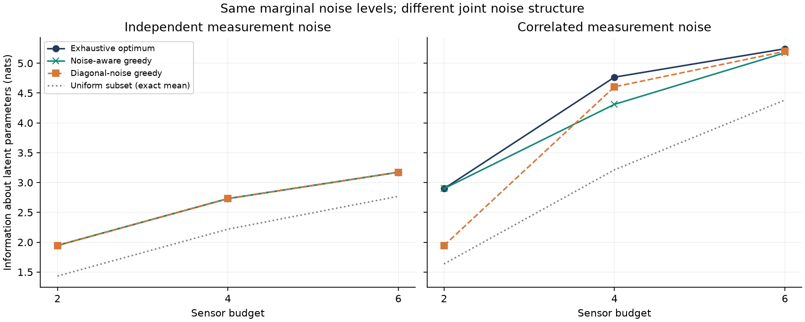
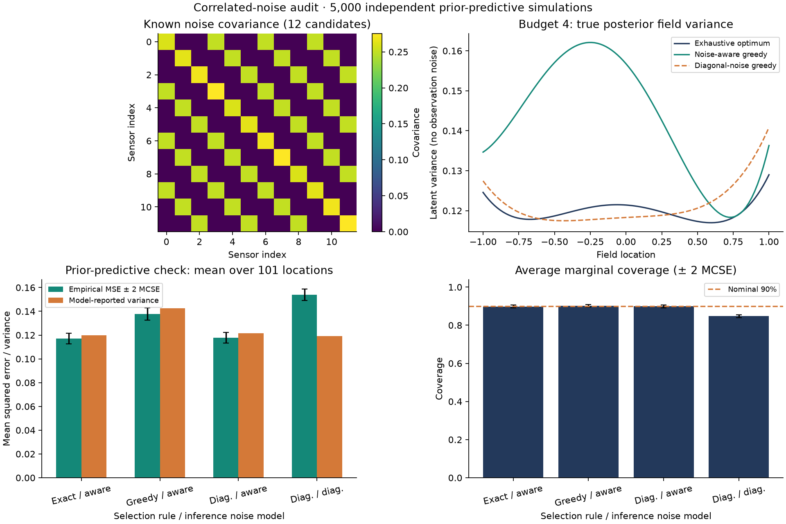

# Correlation-aware sensor design

[](https://github.com/lcx0731/correlation-aware-sensor-design/actions/workflows/tests.yml)

**Which four measurements should you buy when their errors are correlated?**

An original, small Python implementation of Bayesian experimental design that
separates three questions: whether the noise model is right, whether a subset
search finds the optimum, and whether the resulting uncertainty is calibrated.
All data are synthetic. No real sensor deployment or empirical research result
is claimed.

The central finding of this fixed example is deliberately mixed: modeling noise
correlation helps evaluate designs correctly, but a correlation-aware **greedy
search can still lose to a misspecified-model selection heuristic**. Exhaustive
search makes that limitation visible. Using the wrong noise model for inference
is a separate problem: nominal 90% intervals achieve about 84.8% prior-predictive
coverage here.



## Run it

Python 3.11 or newer:

```bash
git clone https://github.com/lcx0731/correlation-aware-sensor-design.git
cd correlation-aware-sensor-design
python3 -m venv .venv
source .venv/bin/activate
python -m pip install '.[test]'
python -W error -m pytest -q
python -W error -m sensor_design.experiment --output results
```

The command writes `summary.json` and two PNG figures. Defaults are seed
`20261010`, 5,000 independent prior-predictive simulations, and budgets 2, 4, 6.
`sensor-design --output results` is the equivalent installed entry point.
For the recorded Python 3.13 dependency snapshot:

```bash
python -m pip install -r requirements-repro.txt
python -m pip install --no-deps .
```

The synthetic design and all subset scores are deterministic; only the
prior-predictive check uses a seeded random generator. Repeated JSON output is
tested on the same environment. Floating-point last bits and PNG rendering may
differ across platforms or dependency versions. After changing source code,
reinstall the package before testing: `python -m pip install --no-deps .`.

## Model and objective

Let the three latent coefficients be `theta ~ N(0, P0)`. Sensor readings follow
`y = H theta + epsilon`, with `epsilon ~ N(0, R)` independent of `theta`.
For a chosen subset `S`, use the **marginal** noise covariance `R[S,S]`; the
unchosen readings have not been observed.

```text
P_S  = (P0^(-1) + H_S' R_SS^(-1) H_S)^(-1)
f(S) = I(theta; y_S) = 0.5 * [log det(P0) - log det(P_S)]
```

`f(S)` is mutual information in nats, equivalent to reducing the log determinant
of posterior parameter covariance (Bayesian D-optimality). It is not mutual
information between selected and unselected sensor locations. Each sensor has
unit cost and can be selected once; a budget means exact subset cardinality.
This criterion does **not** directly minimize mean or worst-case field variance.

The implementation uses Cholesky factors rather than explicit inverses:
if `P0 = L0 L0'` and `R_SS = Lr Lr'`, form
`W = solve(Lr, H_S L0)` and `M = I + W'W`. Then
`P_S = L0 M^(-1) L0'` via a solve, and `f(S) = sum(log(diag(cholesky(M))))`.
Posterior means use `K_S y_S`, where `K_S = P_S H_S' R_SS^(-1)`.

### What is compared?

- **Exhaustive optimum:** evaluate every size-budget subset. There are 66, 495,
  and 924 subsets at budgets 2, 4, and 6 respectively. The generic function
  rejects searches exceeding 100,000 subsets.
- **Noise-aware greedy:** add the candidate giving the largest information
  increase using the full specified covariance.
- **Diagonal-noise greedy:** select with `diag(diag(R))`, but **score that
  selection using the true full `R`**. The information comparison therefore
  measures selection quality, not an optimistic score from the wrong model.
- **Uniform-subset reference:** the exact average of the true objective over
  all size-budget subsets, not a sampled estimate.

Ties within `1e-12` nats retain the first enumerated candidate/subset. Greedy
order is retained in JSON; the exhaustive result is sorted. Reported optimality
gaps are nonnegative, with floating-point negative differences clipped to zero.

### Why there is no correlated-noise submodularity certificate

For independent noise, adding sensor `j` has marginal value

```text
Delta(j | S) = 0.5 * log(1 + h_j' P_S h_j / R_jj).
```

Conditioning on more readings reduces `P_S` in positive-semidefinite order, so
these gains have diminishing returns. For any optimal size-`k` set `O`,
monotonicity and diminishing returns give

```text
f(O) <= f(S union O)
     <= f(S) + sum of Delta(j | S) over j in O minus S
     <= f(S) + sum of the k largest nonnegative remaining marginal gains.
```

We also cap that upper bound at `f(all sensors)`. The API provides this
certificate **only when `R` is diagonal**, without a numerical tolerance for
discarding correlations. It raises an error otherwise; JSON records `null`.

A two-sensor counterexample is included: `P0 = 1`, `H = [1, -1]'`, and
`R = [[1, 0.9], [0.9, 1]]`. Either reading alone gives `0.5 log(2) = 0.3466`
nats, while both give `0.5 log(21) = 1.5223` nats. The second reading's marginal
value rises to `1.1757` nats after the first. Shared noise can cancel in contrasts;
correlation does not universally mean redundancy. No general greedy
approximation guarantee is claimed for the correlated case.

## Fully specified synthetic experiment

There are 12 locations:
`[-1, -.85, -.65, -.45, -.25, -.05, .05, .25, .45, .65, .85, 1]`.
The latent field has Legendre basis `[1, x, (3*x*x - 1)/2]` and
`P0 = diag(1, 0.5, 0.25)`.

Sensor `i` has idiosyncratic noise standard deviation `0.10 + 0.02*(i mod 4)`
and shared-noise group `i mod 3`. With group-indicator matrix `B`,
`R = diag(idiosyncratic_sd**2) + 0.5**2 * B B'`.
The independent scenario keeps the same diagonal variances and removes only
the off-diagonal entries. The groups deliberately span different field
locations. A 101-point uniform grid on `[-1, 1]` is used for prediction checks.
The model and covariance matrices are also saved in the JSON artifact.

### Observed design results

Information in nats, evaluated under each scenario's true noise model:

| Noise | Budget | Exhaustive optimum | Aware greedy | Diagonal greedy |
|---|---:|---:|---:|---:|
| Independent | 2 | 1.945598 | 1.945598 | 1.945598 |
| Independent | 4 | 2.730800 | 2.730800 | 2.730800 |
| Independent | 6 | 3.173134 | 3.173134 | 3.173134 |
| Correlated | 2 | 2.898556 | 2.898556 | 1.945598 |
| Correlated | 4 | 4.766101 | 4.310861 | 4.604588 |
| Correlated | 6 | 5.242233 | 5.175060 | 5.198125 |

For correlated noise at budget 4, the exact design is `{0, 5, 9, 11}`;
aware greedy chooses `{0, 6, 9, 11}` and loses `0.455240` nats. Diagonal greedy
chooses `{0, 5, 6, 11}` and loses only `0.161513` nats. Thus the covariance-aware
greedy heuristic is **not** the winner at every budget. The independent-case
matches with the optimum are properties of these instances, not a general claim.

### Separate selection from inference

At budget 4 in the correlated scenario, simulate 5,000 independent draws of
`theta` and all 12 sensor noises. All four pipelines see the same simulated
realizations. For each draw, average squared latent-field error and marginal
90% interval coverage over the grid. MCSE is the sample standard deviation of
these **per-draw averages** divided by `sqrt(5000)`; grid points are not treated
as independent simulations. Error bars below are approximately two MCSEs.

| Selection / inference | Reported mean variance | Analytic actual MSE | Simulated MSE ± MCSE | Coverage ± MCSE |
|---|---:|---:|---:|---:|
| Exact / aware | 0.119889 | 0.119889 | 0.116979 ± 0.002262 | 89.81% ± 0.38 pp |
| Aware greedy / aware | 0.142537 | 0.142537 | 0.137703 ± 0.002558 | 90.22% ± 0.36 pp |
| Diagonal greedy / aware | 0.121452 | 0.121452 | 0.117902 ± 0.002234 | 89.89% ± 0.37 pp |
| Diagonal greedy / diagonal | 0.119294 | 0.157935 | 0.154036 ± 0.002400 | 84.79% ± 0.37 pp |

For any inference gain `K`, the actual coefficient-error covariance is
`(I-K H_S) P0 (I-K H_S)' + K R_SS K'`, using the **true** noise covariance.
The analytic MSE column projects this covariance onto the field grid. It equals
the reported variance for correctly specified inference, but need not under
misspecification. The last two rows hold sensor selection fixed and change only
the inference model.



## Tests and project structure

The local test run contains **46 passing cases**, covering scalar closed forms,
an independent joint-Gaussian Schur-complement reference, coordinate and subset
permutation invariance, posterior PSD reduction, diminishing returns, independent
upper bounds against exhaustive solutions, the correlated counterexample,
deterministic ties, invalid inputs, exhaustive-search limits, Monte Carlo checks
against analytic MSE, and end-to-end CLI artifact reproducibility.
GitHub Actions tests Python 3.11 and 3.13 and runs the full example.

```text
src/sensor_design/core.py        Model, posterior, selectors, valid certificates
src/sensor_design/experiment.py  Synthetic generator, simulation, figures, CLI
tests/                          Mathematical and integration checks
results/                        Actual generated JSON and two figures
```

The project demonstrates covariance-aware modeling, numerical linear algebra,
combinatorial optimization, assumption checking, and reproducible uncertainty
evaluation. The formulas are standard; this implementation and experiment are
original educational work, not a new estimation method.

## Limits

- A small, known, linear-Gaussian model with positive-definite prior and noise;
  no covariance estimation, nonlinear sensors, non-Gaussian errors, or adversarial
  misspecification is modeled. Extreme ill-conditioning is not certified.
- Selection is static and happens before readings arrive. There are no adaptive
  policies, unequal costs, sensor failures, or deployment constraints.
- Exhaustive enumeration is an audit tool for small instances, not a scalable
  optimizer. Greedy search is a heuristic under correlated noise.
- Coverage is averaged over **the specified prior predictive distribution**
  and marginal field locations. It is not simultaneous-band coverage or a
  fixed-parameter frequentist guarantee.
- One constructed geometry and one simulation seed are not evidence of universal
  performance. The exact design scores do not involve Monte Carlo uncertainty.
- Educational use only; not a production sensor-control system or investment
  advice. No private data, personal records, or external dataset is used.

## References and attribution

- Joshi and Boyd (2009), [Sensor Selection via Convex Optimization](https://web.stanford.edu/~boyd/papers/sensor_selection.html):
  background on finite sensor subset selection and performance bounds. This
  repository does **not** implement their convex-relaxation algorithm or use
  their MATLAB code.
- Krause and Guestrin (UAI 2005), [Near-optimal Nonmyopic Value of Information in Graphical Models](https://arxiv.org/abs/1207.1394):
  background on information-based selection and submodularity. The elementary
  Gaussian argument and explicit failure case used here are stated above.
- SciPy [Cholesky solves](https://docs.scipy.org/doc/scipy/reference/generated/scipy.linalg.cho_solve.html):
  numerical primitives used by the implementation.

Code is licensed under [MIT](LICENSE).
